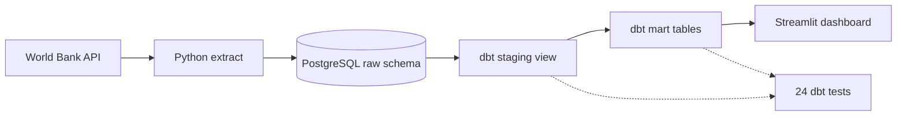
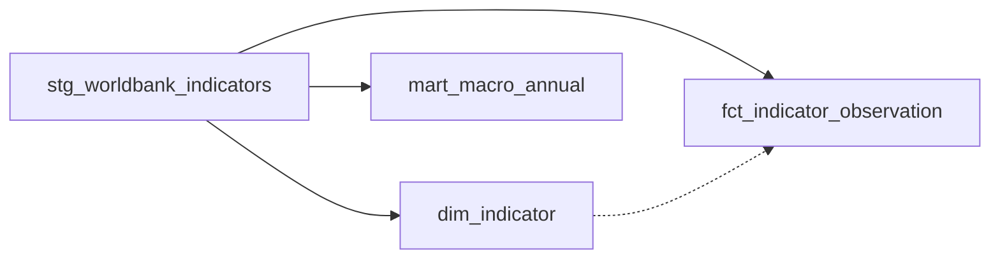

# Morocco Data Platform

**An end-to-end analytics pipeline for Moroccan macroeconomic data** — ingested
from the World Bank API, modelled and tested with dbt, served as an interactive
dashboard.


> **Live demo:** **[morocco-data-platform.streamlit.app](https://morocco-data-platform.streamlit.app)**

---

## Why this project

Morocco publishes a real amount of economic data, but it arrives in
incompatible shapes. Answering something as simple as *"how has inflation moved
relative to the dirham over the last three decades?"* means pulling several
series, reconciling their coverage, and lining them up by year — by hand, every
time you want to ask again.

This builds the pipeline that does it once, correctly, and repeatably: raw
responses land in a warehouse, transformations are version-controlled and
tested, and the result is queryable and visualised.

**330 observations · 5 indicators · 1960–2025 · 24 data quality tests.**

---

## Architecture



The dbt layer in detail:



---

## Stack

| Layer | Tool | Why |
|---|---|---|
| Ingestion | Python, `requests` | Handles pagination, retries, and completeness assertions |
| Storage | PostgreSQL 16 (Docker) | Warehouse for the raw and modelled layers |
| Transformation | dbt | Version-controlled SQL with built-in testing and lineage |
| Visualisation | Streamlit, Plotly | A shareable dashboard straight from the marts |
| Orchestration | Makefile | Cold start to tested warehouse in one target |
| CI | GitHub Actions | Runs the whole pipeline against a real Postgres on every push |

---

## Data model

| Model | Layer | Grain | Rows |
|---|---|---|---|
| `stg_worldbank_indicators` | staging (view) | country · indicator · year | 330 |
| `dim_indicator` | mart | indicator | 5 |
| `fct_indicator_observation` | mart | country · indicator · year | 330 |
| `mart_macro_annual` | mart | country · year | 66 |

`mart_macro_annual` pivots the five series into columns and adds two derived
measures: year-on-year exchange-rate movement, and a trailing three-year
inflation average computed with a window function.

**Natural key:** `(country_code, indicator_code, year)`. The loader upserts on
it, so re-running the pipeline is idempotent — the CI job asserts the row count
is unchanged after a second run.

---

## What the tests actually caught

The schema tests are not decoration. On their first run, `accepted_values` on
`country_code` failed.

The extractor was reading `obs["country"]["id"]`, which is the **ISO-2** code
(`MA`). The adjacent `countryiso3code` field carries **ISO-3** (`MAR`). Both are
present in every response and neither is labelled.

Nothing else would have found it. The pipeline ran clean, the loader reported
the right row count, and every *number* in the warehouse was correct — only the
country identifier was wrong, and it would have stayed wrong until the first
join on an ISO-3 key, long after anyone remembered why.

The other 23 tests cover uniqueness, referential integrity, accepted ranges,
and three singular tests on plausibility — including one asserting inflation
stays within −15…60%, which would catch the API switching from an annual
percentage to an index level.

---

## Data sources

| Indicator | Code | Coverage |
|---|---|---|
| Inflation, consumer prices (annual %) | `FP.CPI.TOTL.ZG` | 100% |
| GDP per capita (current US$) | `NY.GDP.PCAP.CD` | 100% |
| Official exchange rate (MAD per US$) | `PA.NUS.FCRF` | 100% |
| GDP growth (annual %) | `NY.GDP.MKTP.KD.ZG` | 89% |
| Unemployment (% of labour force) | `SL.UEM.TOTL.ZS` | 53% |

All from [World Bank Open Data](https://data.worldbank.org/country/morocco),
openly licensed. No personal data is collected or stored.

Coverage below 100% is real: those years were never published. Missing values
are kept as nulls rather than filled — zero would read as "no inflation that
year", which is a different and false claim.

---

## Quick start

```bash
cp .env.example .env            # then set a password
docker compose up -d            # PostgreSQL 16

python -m venv .venv
.venv\Scripts\activate          # Windows
pip install -r requirements.txt -r requirements-dev.txt

python run_pipeline.py          # extract + load, idempotent
cp transform/profiles.yml.example transform/profiles.yml   # then set the password
dbt deps  --project-dir transform
dbt build --project-dir transform --profiles-dir transform

streamlit run dashboard/app.py  # http://localhost:8501
```

Or with `make`:

```bash
make all          # up, pipeline, build, test
make dashboard
make reset        # wipe the volume and start clean
```

---

## Project structure

```
morocco-data-platform/
├── extract/          # One module per source; asserts completeness
├── load/             # Idempotent upsert into the raw schema
├── transform/        # dbt project: staging, marts, tests
├── dashboard/        # Streamlit app
├── notebooks/        # Source exploration
├── sql/init/         # Schema bootstrap, runs on first container start
├── docs/             # Decision log and pipeline walkthrough
└── .github/workflows # CI
```

---

## Documentation

- **[docs/decisions.md](docs/decisions.md)** — why each choice was made, and
  what was rejected
- **[docs/pipeline-walkthrough.md](docs/pipeline-walkthrough.md)** —
  line-by-line notes on the extractor and loader
- **[notebooks/01_explore_worldbank.ipynb](notebooks/01_explore_worldbank.ipynb)**
  — the source exploration, including the pagination finding

---

## License

MIT — see [LICENSE](LICENSE).
