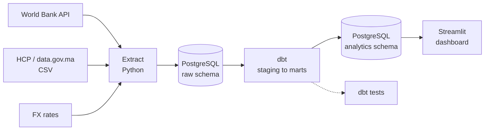

# Morocco Data Platform

**An end-to-end analytics platform for Moroccan public economic data** — ingestion, tested transformations, and an interactive dashboard.

---

## Why this project

Morocco publishes a real amount of economic data, but it lives in incompatible places: the World Bank exposes indicators through a JSON API, the HCP releases consumer price indices as spreadsheets, and exchange rates arrive in a third format entirely. Different schemas, different update cadences, no common key.

Answering something as simple as *"how has inflation moved relative to the exchange rate over the last decade?"* currently means downloading three files and reconciling them by hand, every time.

This project builds the pipeline that does it once, correctly, and repeatably: raw sources land in a warehouse, transformations are version-controlled and tested, and the result is queryable and visualised.

---

## Architecture



---

## Stack

| Layer | Tool | Why |
|---|---|---|
| Ingestion | Python (`requests`, `pandas`) | Handles both API and file sources |
| Storage | PostgreSQL — Docker locally, Azure when deployed | Warehouse for raw and modelled layers |
| Transformation | dbt | Version-controlled SQL with built-in testing and lineage |
| Visualisation | Streamlit | Fast path from queries to a shareable dashboard |
| Environment | Docker Compose | One command to reproduce the database |
| CI | GitHub Actions | Lint and compile checks on every push |

---

## Data sources

| Source | Content | Format |
|---|---|---|
| [World Bank Open Data](https://data.worldbank.org/country/morocco) | Inflation, GDP, unemployment | JSON API |
| [HCP](https://www.hcp.ma/) / [data.gov.ma](https://www.data.gov.ma/) | Consumer price index | CSV |
| Exchange rates | MAD against major currencies | API |

All sources are public and openly licensed. No personal data is collected or stored.

---

## Roadmap

- [ ] Exploratory analysis of source data
- [ ] Extraction layer for all sources
- [ ] Loading into PostgreSQL (`raw` schema), idempotent
- [ ] dbt staging models
- [ ] dbt mart models
- [ ] Data quality tests
- [ ] Streamlit dashboard
- [ ] Deployed demo
- [ ] CI pipeline

---

## Getting started

```bash
# 1. Database
cp .env.example .env          # then edit the password
docker compose up -d
docker compose ps             # postgres should be "healthy"

# 2. Python environment
python -m venv .venv
.venv\Scripts\activate       # Windows
pip install -r requirements.txt
```

Useful afterwards:

```bash
docker compose down           # stop, keep the data
docker compose down -v        # stop and wipe the data
```

---

## Project structure

```
morocco-data-platform/
├── extract/          # One module per data source
├── load/             # Loading into PostgreSQL
├── transform/        # dbt project
├── dashboard/        # Streamlit app
├── notebooks/        # Exploratory analysis
├── data/             # Local files (gitignored)
├── docs/             # Architecture and decision records
├── docker-compose.yml
└── Makefile
```

---

## License

MIT — see [LICENSE](LICENSE).
